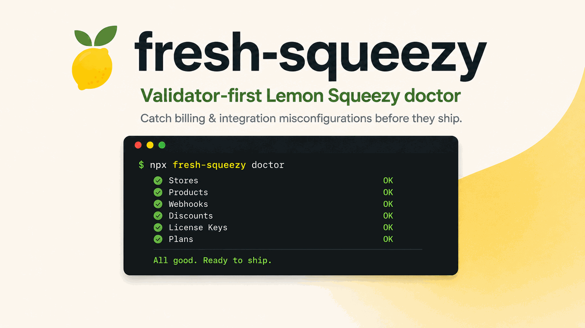

<!-- Traducido de README.md; la versión en inglés es la fuente de verdad. -->

<p align="center">
  <a href="https://github.com/YosefHayim/fresh-squeezy">
    
  </a>
</p>

<p align="center">
  <strong>El cliente actualizado de Lemon Squeezy para TypeScript, más un doctor que detecta errores de configuración de facturación antes de que lleguen a producción.</strong>
</p>

<p align="center">
  <a href="https://www.npmjs.com/package/fresh-squeezy"></a>
  <a href="https://www.npmjs.com/package/fresh-squeezy"></a>
  <a href="https://github.com/YosefHayim/fresh-squeezy/actions/workflows/ci.yml"></a>
  <a href="./LICENSE"></a>
  
  
  <a href="https://packagephobia.com/result?p=fresh-squeezy"></a>
</p>

<p align="center">
  <a href="./README.md">English</a> ·
  <a href="./README.zh-CN.md">简体中文</a> ·
  <a href="./README.ja.md">日本語</a> ·
  <b>Español</b> ·
  <a href="./README.pt-BR.md">Português</a>
</p>

<p align="center">
  <a href="#instalación">Instalación</a> ·
  <a href="#cliente">Cliente</a> ·
  <a href="#doctor">Doctor</a> ·
  <a href="#reemplazar-lemonsqueezylemonsqueezyjs">Reemplazar el SDK</a> ·
  <a href="#actualizar-desde-03">Actualizar desde 0.3</a> ·
  <a href="#mantener-los-tipos-al-día">Mantener los tipos al día</a> ·
  <a href="#códigos-de-hallazgo">Códigos de hallazgo</a>
</p>

---

**fresh-squeezy** son dos cosas para [Lemon Squeezy](https://www.lemonsqueezy.com/):

1. **Un cliente tipado** que reemplaza a [`@lemonsqueezy/lemonsqueezy.js`](https://github.com/lmsqueezy/lemonsqueezy.js). El SDK oficial publicó por última vez la 4.0.0 el 2024-11-05; fresh-squeezy sigue el [registro de cambios de la API](https://docs.lemonsqueezy.com/api/getting-started/changelog). Cero dependencias en tiempo de ejecución, ESM y CJS.
2. **Un doctor** que revisa una tienda antes de publicar: conexión y modo, tienda, productos, planes de suscripción, webhooks, descuentos y claves de licencia. Da códigos de hallazgo estables, códigos de salida estables y JSON para CI.

Node 22 o superior.

## Instalación

```bash
pnpm add fresh-squeezy
```

Define una clave de API por modo. `LEMON_SQUEEZY_MODE` elige la clave y es `test` por defecto.

```bash
LEMON_SQUEEZY_TEST_API_KEY=your-test-key
LEMON_SQUEEZY_LIVE_API_KEY=your-live-key
LEMON_SQUEEZY_MODE=test
LEMON_SQUEEZY_STORE_ID=12
```

Solo hace falta la clave del modo que usas, y `LEMON_SQUEEZY_STORE_ID` es opcional. Los mismos ajustes funcionan como opciones de `createFreshSqueezy({ apiKey, mode, storeId, baseUrl })`.

## Cliente

El nombre del recurso elige los tipos. Los nombres de atributos usan snake_case, como los envía la API.

```ts
import { createFreshSqueezy } from "fresh-squeezy";

const freshSqueezy = createFreshSqueezy();

const subscription = await freshSqueezy.get("subscriptions", "123");
const paidOrders = await freshSqueezy.list("orders", {
	store_id: 1,
	status: "paid",
});

await freshSqueezy.create("checkouts", {
	attributes: { checkout_data: { email: "ada@example.com" } },
	relationships: { store: "1", variant: "2" },
});
await freshSqueezy.update("subscriptions", "123", { pause: { mode: "void" } });
await freshSqueezy.remove("webhooks", "9");
await freshSqueezy.cancelSubscription("123");
await freshSqueezy.refund("orders", "55", 500);
await freshSqueezy.generateInvoice("orders", "55", {
	name,
	address,
	city,
	state,
	zip_code,
	country,
});
await freshSqueezy.currentUsage("77");
```

- `list` lee todas las páginas. Los filtros se convierten en parámetros `filter[...]`.
- Una llamada fallida lanza un `FreshSqueezyError` (un `Error` simple con `code`, `status` y `detail`). Compruébalo con `isFreshSqueezyError` de `fresh-squeezy/errors` y ramifica según `.code`.
- El cliente solo tiene las llamadas que listan los [documentos de la API de Lemon Squeezy](https://docs.lemonsqueezy.com/api). Los productos, variantes y precios no tienen API de escritura, así que aquí tampoco hay escritura.

La API de licencias no necesita clave de API y tiene su propio subpath:

```ts
import {
	activateLicense,
	validateLicense,
	deactivateLicense,
} from "fresh-squeezy/license";

await activateLicense({ licenseKey, instanceName });
await validateLicense({ licenseKey, instanceId }); // instanceId es opcional
await deactivateLicense({ licenseKey, instanceId });
```

Cada llamada devuelve la respuesta de la API, también en un 4xx: revisa `activated`, `valid` o `deactivated`, y `error`. Solo lanza un `FreshSqueezyError` cuando falla la red o la respuesta no es JSON.

## Doctor

```bash
# Todas las tiendas a las que llega la clave
npx fresh-squeezy doctor

# Una tienda, más todos sus productos, planes, webhooks, descuentos y claves de licencia
npx fresh-squeezy doctor --store-id 12 --all-resources

# Dos tiendas, una URL de webhook, salida legible por máquina
npx fresh-squeezy doctor --store-id 12 --store-id 34 \
  --webhook-url https://app.example.com/api/webhooks/lemon-squeezy --json
```

| Opción                  | Significado                                                                                       |
| ----------------------- | ------------------------------------------------------------------------------------------------- |
| `--mode <test\|live>`   | Modo a revisar. Por defecto: `LEMON_SQUEEZY_MODE`, si no `test`                                   |
| `--store-id <id>`       | Tienda a revisar, repite para más. Por defecto: `LEMON_SQUEEZY_STORE_ID`, si no todas las tiendas |
| `--all-resources`       | Revisa también cada producto, plan, webhook, descuento y clave de licencia de cada tienda         |
| `--product-id <id>`     | Producto a revisar, repite para más                                                               |
| `--variant-id <id>`     | Plan de suscripción a revisar, repite para más                                                    |
| `--webhook-url <url>`   | Webhook a revisar, repite para más                                                                |
| `--discount-id <id>`    | Descuento a revisar, repite para más                                                              |
| `--license-key-id <id>` | Clave de licencia a revisar, repite para más                                                      |
| `--json`                | Imprime los informes como JSON                                                                    |
| `--help`, `--version`   | Muestra la ayuda o la versión                                                                     |

El doctor lee la clave de su modo (`LEMON_SQUEEZY_TEST_API_KEY` o `LEMON_SQUEEZY_LIVE_API_KEY`) del entorno o de un archivo `.env` en el directorio de trabajo. Nunca pregunta y nunca se queda colgado.

| Salida | Significado                                                                 |
| ------ | --------------------------------------------------------------------------- |
| `0`    | Todas las comprobaciones pasaron                                            |
| `1`    | Una comprobación falló                                                      |
| `2`    | Opciones o configuración incorrectas (falta la clave, modo o flag inválido) |

`--json` imprime un objeto:

```json
{
	"ok": false,
	"mode": "test",
	"reports": [
		{
			"ok": false,
			"mode": "test",
			"results": [
				{
					"name": "discount",
					"ok": false,
					"mode": "test",
					"target": { "label": "discount", "id": "77" },
					"findings": [
						{
							"code": "DISCOUNT_EXPIRED",
							"severity": "error",
							"message": "...",
							"suggestedFix": "..."
						}
					]
				}
			]
		}
	]
}
```

`reports` tiene un informe por tienda. Una comprobación es `ok` cuando no tiene hallazgos de nivel `error`.

### CI

```yaml
- name: Check Lemon Squeezy
  run: npx fresh-squeezy doctor --all-resources --json
  env:
    LEMON_SQUEEZY_LIVE_API_KEY: ${{ secrets.LEMON_SQUEEZY_LIVE_API_KEY }}
    LEMON_SQUEEZY_MODE: live
```

El paso falla con salida `1` o `2`. Una clave de producción apuntando a una tienda de prueba (o al revés) genera `MODE_MISMATCH`: el doctor compara el modo declarado con `meta.test_mode` de `/v1/users/me`.

### Las comprobaciones desde TypeScript

Cada comprobación devuelve un `ValidationResult` y nunca lanza excepciones.

```ts
const freshSqueezy = createFreshSqueezy({ mode: "live" });

const connection = await freshSqueezy.validateConnection();
const discount = await freshSqueezy.validateDiscount({
	storeId: "12",
	discountId: "77",
});
const report = await freshSqueezy.doctor({ storeId: "12", allResources: true });
const storeIds = await freshSqueezy.listStoreIds();

for (const check of report.results) {
	for (const finding of check.findings) {
		console.error(`[${finding.severity}] ${finding.code}: ${finding.message}`);
	}
}
```

Las comprobaciones: `validateConnection`, `validateStore`, `validateProduct`, `validateSubscriptionPlan`, `validateWebhook`, `validateDiscount`, `validateLicenseKey`, y `doctor`, que las ejecuta para una tienda. Los tipos de resultados y hallazgos vienen de `fresh-squeezy/findings`.

## Reemplazar @lemonsqueezy/lemonsqueezy.js

Cada función que exporta el SDK y la llamada de fresh-squeezy que la reemplaza. Estas diferencias valen para todas las filas:

- `lemonSqueezySetup` pasa a ser `createFreshSqueezy`. No hay estado global: conserva el objeto que devuelve.
- El SDK devuelve `{ statusCode, data, error }`. fresh-squeezy devuelve el recurso y lanza un `FreshSqueezyError` si falla.
- Los atributos usan snake_case (`variant_id`), no camelCase (`variantId`). Los ids son cadenas.
- `archiveCustomer` es `update("customers", id, { status: "archived" })`, como describe la [documentación de actualizar cliente](https://docs.lemonsqueezy.com/api/customers/update-customer).
- Las funciones de licencia pasan a `fresh-squeezy/license`.

| `@lemonsqueezy/lemonsqueezy.js`   | `fresh-squeezy`                                                                       |
| --------------------------------- | ------------------------------------------------------------------------------------- |
| `activateLicense`                 | `activateLicense({ licenseKey, instanceName })` from `fresh-squeezy/license`          |
| `archiveCustomer`                 | `update("customers", id, { status: "archived" })`                                     |
| `cancelSubscription`              | `cancelSubscription(id)`                                                              |
| `createCheckout`                  | `create("checkouts", { attributes, relationships: { store, variant } })`              |
| `createCustomer`                  | `create("customers", { attributes, relationships: { store: storeId } })`              |
| `createDiscount`                  | `create("discounts", { attributes, relationships: { store, variants } })`             |
| `createUsageRecord`               | `create("usage-records", { attributes, relationships: { "subscription-item": id } })` |
| `createWebhook`                   | `create("webhooks", { attributes, relationships: { store: storeId } })`               |
| `deactivateLicense`               | `deactivateLicense({ licenseKey, instanceId })` from `fresh-squeezy/license`          |
| `deleteDiscount`                  | `remove("discounts", id)`                                                             |
| `deleteWebhook`                   | `remove("webhooks", id)`                                                              |
| `generateOrderInvoice`            | `generateInvoice("orders", id, billing)`                                              |
| `generateSubscriptionInvoice`     | `generateInvoice("subscription-invoices", id, billing)`                               |
| `getAuthenticatedUser`            | `get("users", "me")`                                                                  |
| `getCheckout`                     | `get("checkouts", id)`                                                                |
| `getCustomer`                     | `get("customers", id)`                                                                |
| `getDiscount`                     | `get("discounts", id)`                                                                |
| `getDiscountRedemption`           | `get("discount-redemptions", id)`                                                     |
| `getFile`                         | `get("files", id)`                                                                    |
| `getLicenseKey`                   | `get("license-keys", id)`                                                             |
| `getLicenseKeyInstance`           | `get("license-key-instances", id)`                                                    |
| `getOrder`                        | `get("orders", id)`                                                                   |
| `getOrderItem`                    | `get("order-items", id)`                                                              |
| `getPrice`                        | `get("prices", id)`                                                                   |
| `getProduct`                      | `get("products", id)`                                                                 |
| `getStore`                        | `get("stores", id)`                                                                   |
| `getSubscription`                 | `get("subscriptions", id)`                                                            |
| `getSubscriptionInvoice`          | `get("subscription-invoices", id)`                                                    |
| `getSubscriptionItem`             | `get("subscription-items", id)`                                                       |
| `getSubscriptionItemCurrentUsage` | `currentUsage(subscriptionItemId)`                                                    |
| `getUsageRecord`                  | `get("usage-records", id)`                                                            |
| `getVariant`                      | `get("variants", id)`                                                                 |
| `getWebhook`                      | `get("webhooks", id)`                                                                 |
| `issueOrderRefund`                | `refund("orders", id, amount)`                                                        |
| `issueSubscriptionInvoiceRefund`  | `refund("subscription-invoices", id, amount)`                                         |
| `lemonSqueezySetup`               | `createFreshSqueezy({ apiKey })`                                                      |
| `listCheckouts`                   | `list("checkouts", filter)`                                                           |
| `listCustomers`                   | `list("customers", filter)`                                                           |
| `listDiscountRedemptions`         | `list("discount-redemptions", filter)`                                                |
| `listDiscounts`                   | `list("discounts", filter)`                                                           |
| `listFiles`                       | `list("files", filter)`                                                               |
| `listLicenseKeyInstances`         | `list("license-key-instances", filter)`                                               |
| `listLicenseKeys`                 | `list("license-keys", filter)`                                                        |
| `listOrderItems`                  | `list("order-items", filter)`                                                         |
| `listOrders`                      | `list("orders", filter)`                                                              |
| `listPrices`                      | `list("prices", filter)`                                                              |
| `listProducts`                    | `list("products", filter)`                                                            |
| `listStores`                      | `list("stores", filter)`                                                              |
| `listSubscriptionInvoices`        | `list("subscription-invoices", filter)`                                               |
| `listSubscriptionItems`           | `list("subscription-items", filter)`                                                  |
| `listSubscriptions`               | `list("subscriptions", filter)`                                                       |
| `listUsageRecords`                | `list("usage-records", filter)`                                                       |
| `listVariants`                    | `list("variants", filter)`                                                            |
| `listWebhooks`                    | `list("webhooks", filter)`                                                            |
| `updateCustomer`                  | `update("customers", id, attributes)`                                                 |
| `updateLicenseKey`                | `update("license-keys", id, attributes)`                                              |
| `updateSubscription`              | `update("subscriptions", id, attributes)`                                             |
| `updateSubscriptionItem`          | `update("subscription-items", id, attributes)`                                        |
| `updateWebhook`                   | `update("webhooks", id, attributes)`                                                  |
| `validateLicense`                 | `validateLicense({ licenseKey, instanceId })` from `fresh-squeezy/license`            |

Las 60 filas son todas las funciones que exporta `@lemonsqueezy/lemonsqueezy.js` 4.0.0.

## Actualizar desde 0.3

- Los comandos ops y el registro de verbos ya no existen. Usa el [cliente](#cliente).
- `init`, `manage`, los subcomandos `validate`, las augmentations y el menú del lanzador ya no existen. El único comando es `fresh-squeezy doctor`, y solo acepta opciones.
- `--store-ids a,b` ahora es `--store-id a --store-id b`. Sin tienda indicada, el doctor revisa todas las tiendas, así que `--all-stores` es el valor por defecto.
- Los issues ahora son hallazgos: `ISSUE_CODES` es `FINDING_CODES`, `issue.code` es `finding.code` y la clave JSON `issues` es `findings`. Los códigos no cambian, salvo `STORE_NOT_OWNED`, que se eliminó (nada lo generaba).
- Los subpaths exportados ahora son `.`, `./config`, `./errors`, `./findings`, `./types` y `./license`.
- Node 22 o superior. Las dependencias en tiempo de ejecución desaparecieron.

```ts
// antes
import { validateStore } from "fresh-squeezy/validate/store";
if (result.issues.length > 0) console.error(result.issues[0].code);

// después
import { createFreshSqueezy } from "fresh-squeezy";
const freshSqueezy = createFreshSqueezy();
const result = await freshSqueezy.validateStore("12");
if (result.findings.length > 0) console.error(result.findings[0].code);
```

## Mantener los tipos al día

El workflow `lemon-squeezy-changelog` se ejecuta el día 1 y el 15 de cada mes. Cuando la entrada más reciente del [registro de cambios de la API](https://docs.lemonsqueezy.com/api/getting-started/changelog) aún no tiene issue, abre uno con la etiqueta `changelog-drift`.

Para arreglarlo, lee la entrada, edita a mano `src/shared/lemon-squeezy-types.ts` y el cliente, agrega una prueba y cierra el issue. Un agente puede encargarse del issue.

En un repositorio público, GitHub desactiva los workflows programados tras 60 días sin actividad. Vuelve a activarlo con:

```bash
gh workflow enable lemon-squeezy-changelog
```

## Códigos de hallazgo

Ramifica según `finding.code` en CI. Los códigos son estables entre versiones menores.

| Código                                                               | Significado                                                          |
| -------------------------------------------------------------------- | -------------------------------------------------------------------- |
| `AUTH_FAILED`                                                        | Clave de API inválida o ausente                                      |
| `MODE_MISMATCH`                                                      | El modo declarado no coincide con el `meta.test_mode` de la clave    |
| `STORE_NOT_FOUND`                                                    | No se encontró el ID de tienda para esta clave                       |
| `PRODUCT_UNPUBLISHED` / `PRODUCT_WRONG_STORE` / `PRODUCT_NO_BUY_URL` | El producto no puede aceptar un checkout                             |
| `PLAN_INVALID_INTERVAL` / `PLAN_FREE_PRICE`                          | El plan de suscripción tiene un intervalo inválido o no tiene precio |
| `WEBHOOK_NOT_FOUND` / `WEBHOOK_EVENTS_MISSING`                       | La URL del webhook no está registrada o faltan eventos de pedido     |
| `DISCOUNT_EXPIRED` / `DISCOUNT_REDEMPTIONS_EXHAUSTED`                | El descuento no se puede usar                                        |
| `LICENSE_KEY_DISABLED` / `LICENSE_KEY_EXPIRED`                       | La clave de licencia no se puede activar                             |

La lista completa es `FINDING_CODES` en `fresh-squeezy/findings`.

## Contribuir

Requisitos: Node.js 22+ y pnpm 10.

```bash
git clone https://github.com/YosefHayim/fresh-squeezy.git
cd fresh-squeezy
pnpm install
pnpm verify
```

Lee [PROJECT.md](./PROJECT.md) para los objetivos y no objetivos, [AGENTS.md](./AGENTS.md) para los comandos, reglas y recetas, y [CONTEXT.md](./CONTEXT.md) para la forma del código.

Al abrir un issue, incluye la versión de `fresh-squeezy`, la versión de Node, el modo, una reproducción mínima y la salida `--json` del doctor sin la clave.

## Colaboradores

<a href="https://github.com/YosefHayim/fresh-squeezy/graphs/contributors">
  
</a>

## Licencia

MIT — consulta [LICENSE](./LICENSE).
