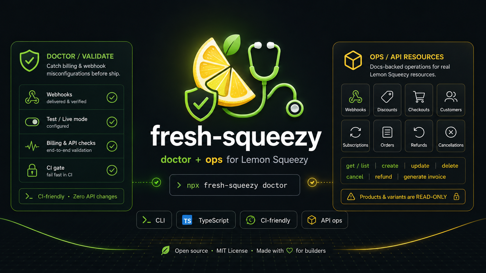

<!-- Traduzido de README.md; a versão em inglês é a fonte da verdade. -->

<p align="center">
  <a href="https://github.com/YosefHayim/fresh-squeezy">
    
  </a>
</p>

<p align="center">
  <strong>O cliente atualizado do Lemon Squeezy para TypeScript, mais um doctor que pega erros de configuração de cobrança antes de irem para produção.</strong>
</p>

<p align="center">
  <a href="https://www.npmjs.com/package/fresh-squeezy"></a>
  <a href="https://www.npmjs.com/package/fresh-squeezy"></a>
  <a href="https://github.com/YosefHayim/fresh-squeezy/actions/workflows/ci.yml"></a>
  <a href="./LICENSE"></a>
  
  
  <a href="https://packagephobia.com/result?p=fresh-squeezy"></a>
</p>

<p align="center">
  <a href="./README.md">English</a> ·
  <a href="./README.zh-CN.md">简体中文</a> ·
  <a href="./README.ja.md">日本語</a> ·
  <a href="./README.es.md">Español</a> ·
  <b>Português</b>
</p>

<p align="center">
  <a href="#instalação">Instalação</a> ·
  <a href="#cliente">Cliente</a> ·
  <a href="#doctor">Doctor</a> ·
  <a href="#substituir-lemonsqueezylemonsqueezyjs">Substituir o SDK</a> ·
  <a href="#atualizando-da-03">Atualizando da 0.3</a> ·
  <a href="#manter-os-tipos-em-dia">Manter os tipos em dia</a> ·
  <a href="#códigos-de-achado">Códigos de achado</a>
</p>

---

**fresh-squeezy** substitui o SDK do Lemon Squeezy, que não é mais mantido, para que cada app tenha cobrança tipada e verificada sem escrever seus próprios tipos nem testes. São duas coisas para o [Lemon Squeezy](https://www.lemonsqueezy.com/):

1. **Um cliente tipado** que substitui o [`@lemonsqueezy/lemonsqueezy.js`](https://github.com/lmsqueezy/lemonsqueezy.js). O SDK oficial lançou a 4.0.0 pela última vez em 2024-11-05; o fresh-squeezy acompanha o [changelog da API](https://docs.lemonsqueezy.com/api/getting-started/changelog). Zero dependências em tempo de execução, ESM e CJS.
2. **Um doctor** que confere uma loja antes de ir ao ar: conexão e modo, loja, produtos, planos de assinatura, webhooks, descontos e chaves de licença. Entrega códigos de achado estáveis, códigos de saída estáveis e JSON para CI.

Node 22 ou superior.

## Instalação

```bash
pnpm add fresh-squeezy
```

Defina uma chave de API por modo. `LEMON_SQUEEZY_MODE` escolhe a chave, e o padrão é `test`.

```bash
LEMON_SQUEEZY_TEST_API_KEY=your-test-key
LEMON_SQUEEZY_LIVE_API_KEY=your-live-key
LEMON_SQUEEZY_MODE=test
LEMON_SQUEEZY_STORE_ID=12
```

Só a chave do modo que você usa é necessária, e `LEMON_SQUEEZY_STORE_ID` é opcional. As mesmas configurações funcionam como opções de `createFreshSqueezy({ apiKey, mode, storeId, baseUrl })`.

## Cliente

O nome do recurso escolhe os tipos. Os nomes dos atributos usam snake_case, como a API os envia.

```ts
import { createFreshSqueezy } from "fresh-squeezy";

const freshSqueezy = createFreshSqueezy();

const subscription = await freshSqueezy.get("subscriptions", "123");
const paidOrders = await freshSqueezy.list("orders", {
	store_id: 1,
	status: "paid",
});

await freshSqueezy.create("checkouts", {
	attributes: { checkout_data: { email: "ada@example.com" } },
	relationships: { store: "1", variant: "2" },
});
await freshSqueezy.update("subscriptions", "123", { pause: { mode: "void" } });
await freshSqueezy.remove("webhooks", "9");
await freshSqueezy.cancelSubscription("123");
await freshSqueezy.refund("orders", "55", 500);
await freshSqueezy.generateInvoice("orders", "55", {
	name,
	address,
	city,
	state,
	zip_code,
	country,
});
await freshSqueezy.currentUsage("77");
```

- `list` lê todas as páginas. Os filtros viram parâmetros `filter[...]`.
- Uma chamada que falha lança um `FreshSqueezyError` (um `Error` simples com `code`, `status` e `detail`). Confira com `isFreshSqueezyError` de `fresh-squeezy/errors` e ramifique por `.code`.
- O cliente só tem as chamadas que a [documentação da API do Lemon Squeezy](https://docs.lemonsqueezy.com/api) lista. Produtos, variantes e preços não têm API de escrita, então aqui também não há escrita.

A API de licenças não precisa de chave de API e tem seu próprio subpath:

```ts
import {
	activateLicense,
	validateLicense,
	deactivateLicense,
} from "fresh-squeezy/license";

await activateLicense({ licenseKey, instanceName });
await validateLicense({ licenseKey, instanceId }); // instanceId é opcional
await deactivateLicense({ licenseKey, instanceId });
```

Cada chamada retorna a resposta da API, também em um 4xx: confira `activated`, `valid` ou `deactivated`, e `error`. Ela só lança um `FreshSqueezyError` quando a rede falha ou a resposta não é JSON.

## Doctor

```bash
# Todas as lojas que a chave alcança
npx fresh-squeezy doctor

# Uma loja, mais todos os produtos, planos, webhooks, descontos e chaves de licença dela
npx fresh-squeezy doctor --store-id 12 --all-resources

# Duas lojas, uma URL de webhook, saída legível por máquina
npx fresh-squeezy doctor --store-id 12 --store-id 34 \
  --webhook-url https://app.example.com/api/webhooks/lemon-squeezy --json
```

| Opção                   | Significado                                                                               |
| ----------------------- | ----------------------------------------------------------------------------------------- |
| `--mode <test\|live>`   | Modo a conferir. Padrão: `LEMON_SQUEEZY_MODE`, senão `test`                               |
| `--store-id <id>`       | Loja a conferir, repita para mais. Padrão: `LEMON_SQUEEZY_STORE_ID`, senão todas as lojas |
| `--all-resources`       | Confere também cada produto, plano, webhook, desconto e chave de licença de cada loja     |
| `--product-id <id>`     | Produto a conferir, repita para mais                                                      |
| `--variant-id <id>`     | Plano de assinatura a conferir, repita para mais                                          |
| `--webhook-url <url>`   | Webhook a conferir, repita para mais                                                      |
| `--discount-id <id>`    | Desconto a conferir, repita para mais                                                     |
| `--license-key-id <id>` | Chave de licença a conferir, repita para mais                                             |
| `--json`                | Imprime os relatórios em JSON                                                             |
| `--help`, `--version`   | Mostra a ajuda ou a versão                                                                |

O doctor lê a chave do seu modo (`LEMON_SQUEEZY_TEST_API_KEY` ou `LEMON_SQUEEZY_LIVE_API_KEY`) do ambiente ou de um arquivo `.env` no diretório de trabalho. Ele nunca pergunta nada e nunca trava.

| Saída | Significado                                                           |
| ----- | --------------------------------------------------------------------- |
| `0`   | Todas as verificações passaram                                        |
| `1`   | Uma verificação falhou                                                |
| `2`   | Opções ou configuração erradas (chave ausente, modo ou flag inválido) |

`--json` imprime um objeto:

```json
{
	"ok": false,
	"mode": "test",
	"reports": [
		{
			"ok": false,
			"mode": "test",
			"checks": [
				{
					"name": "discount",
					"ok": false,
					"mode": "test",
					"target": { "label": "discount", "id": "77" },
					"findings": [
						{
							"code": "DISCOUNT_EXPIRED",
							"severity": "error",
							"message": "...",
							"suggestedFix": "..."
						}
					]
				}
			]
		}
	]
}
```

`reports` tem um relatório por loja. Uma verificação é `ok` quando não tem achado de nível `error`.

### CI

```yaml
- name: Check Lemon Squeezy
  run: npx fresh-squeezy doctor --all-resources --json
  env:
    LEMON_SQUEEZY_LIVE_API_KEY: ${{ secrets.LEMON_SQUEEZY_LIVE_API_KEY }}
    LEMON_SQUEEZY_MODE: live
```

O passo falha com saída `1` ou `2`. Uma chave de produção apontando para uma loja de teste (ou o contrário) gera `MODE_MISMATCH`: o doctor compara o modo declarado com `meta.test_mode` de `/v1/users/me`.

### As verificações pelo TypeScript

Cada verificação devolve um `CheckReport` e nunca lança exceção.

```ts
const freshSqueezy = createFreshSqueezy({ mode: "live" });

const connection = await freshSqueezy.validateConnection();
const discount = await freshSqueezy.validateDiscount({
	storeId: "12",
	discountId: "77",
});
const report = await freshSqueezy.doctor({ storeId: "12", allResources: true });
const storeIds = await freshSqueezy.listStoreIds();

for (const check of report.checks) {
	for (const finding of check.findings) {
		console.error(`[${finding.severity}] ${finding.code}: ${finding.message}`);
	}
}
```

As verificações: `validateConnection`, `validateStore`, `validateProduct`, `validateSubscriptionPlan`, `validateWebhook`, `validateDiscount`, `validateLicenseKey`, e `doctor`, que as executa para uma loja. Os tipos de resultados e achados vêm de `fresh-squeezy/findings`.

## Substituir @lemonsqueezy/lemonsqueezy.js

Cada função que o SDK exporta e a chamada do fresh-squeezy que a substitui. Estas diferenças valem para todas as linhas:

- `lemonSqueezySetup` vira `createFreshSqueezy`. Não há estado global: guarde o objeto que ela devolve.
- O SDK devolve `{ statusCode, data, error }`. O fresh-squeezy devolve o recurso e lança um `FreshSqueezyError` em caso de falha.
- Os atributos usam snake_case (`variant_id`), não camelCase (`variantId`). Os ids são strings.
- `archiveCustomer` é `update("customers", id, { status: "archived" })`, como descreve a [documentação de atualizar cliente](https://docs.lemonsqueezy.com/api/customers/update-customer).
- As funções de licença foram para `fresh-squeezy/license`.

| `@lemonsqueezy/lemonsqueezy.js`   | `fresh-squeezy`                                                                       |
| --------------------------------- | ------------------------------------------------------------------------------------- |
| `activateLicense`                 | `activateLicense({ licenseKey, instanceName })` from `fresh-squeezy/license`          |
| `archiveCustomer`                 | `update("customers", id, { status: "archived" })`                                     |
| `cancelSubscription`              | `cancelSubscription(id)`                                                              |
| `createCheckout`                  | `create("checkouts", { attributes, relationships: { store, variant } })`              |
| `createCustomer`                  | `create("customers", { attributes, relationships: { store: storeId } })`              |
| `createDiscount`                  | `create("discounts", { attributes, relationships: { store, variants } })`             |
| `createUsageRecord`               | `create("usage-records", { attributes, relationships: { "subscription-item": id } })` |
| `createWebhook`                   | `create("webhooks", { attributes, relationships: { store: storeId } })`               |
| `deactivateLicense`               | `deactivateLicense({ licenseKey, instanceId })` from `fresh-squeezy/license`          |
| `deleteDiscount`                  | `remove("discounts", id)`                                                             |
| `deleteWebhook`                   | `remove("webhooks", id)`                                                              |
| `generateOrderInvoice`            | `generateInvoice("orders", id, billing)`                                              |
| `generateSubscriptionInvoice`     | `generateInvoice("subscription-invoices", id, billing)`                               |
| `getAuthenticatedUser`            | `get("users", "me")`                                                                  |
| `getCheckout`                     | `get("checkouts", id)`                                                                |
| `getCustomer`                     | `get("customers", id)`                                                                |
| `getDiscount`                     | `get("discounts", id)`                                                                |
| `getDiscountRedemption`           | `get("discount-redemptions", id)`                                                     |
| `getFile`                         | `get("files", id)`                                                                    |
| `getLicenseKey`                   | `get("license-keys", id)`                                                             |
| `getLicenseKeyInstance`           | `get("license-key-instances", id)`                                                    |
| `getOrder`                        | `get("orders", id)`                                                                   |
| `getOrderItem`                    | `get("order-items", id)`                                                              |
| `getPrice`                        | `get("prices", id)`                                                                   |
| `getProduct`                      | `get("products", id)`                                                                 |
| `getStore`                        | `get("stores", id)`                                                                   |
| `getSubscription`                 | `get("subscriptions", id)`                                                            |
| `getSubscriptionInvoice`          | `get("subscription-invoices", id)`                                                    |
| `getSubscriptionItem`             | `get("subscription-items", id)`                                                       |
| `getSubscriptionItemCurrentUsage` | `currentUsage(subscriptionItemId)`                                                    |
| `getUsageRecord`                  | `get("usage-records", id)`                                                            |
| `getVariant`                      | `get("variants", id)`                                                                 |
| `getWebhook`                      | `get("webhooks", id)`                                                                 |
| `issueOrderRefund`                | `refund("orders", id, amount)`                                                        |
| `issueSubscriptionInvoiceRefund`  | `refund("subscription-invoices", id, amount)`                                         |
| `lemonSqueezySetup`               | `createFreshSqueezy({ apiKey })`                                                      |
| `listCheckouts`                   | `list("checkouts", filter)`                                                           |
| `listCustomers`                   | `list("customers", filter)`                                                           |
| `listDiscountRedemptions`         | `list("discount-redemptions", filter)`                                                |
| `listDiscounts`                   | `list("discounts", filter)`                                                           |
| `listFiles`                       | `list("files", filter)`                                                               |
| `listLicenseKeyInstances`         | `list("license-key-instances", filter)`                                               |
| `listLicenseKeys`                 | `list("license-keys", filter)`                                                        |
| `listOrderItems`                  | `list("order-items", filter)`                                                         |
| `listOrders`                      | `list("orders", filter)`                                                              |
| `listPrices`                      | `list("prices", filter)`                                                              |
| `listProducts`                    | `list("products", filter)`                                                            |
| `listStores`                      | `list("stores", filter)`                                                              |
| `listSubscriptionInvoices`        | `list("subscription-invoices", filter)`                                               |
| `listSubscriptionItems`           | `list("subscription-items", filter)`                                                  |
| `listSubscriptions`               | `list("subscriptions", filter)`                                                       |
| `listUsageRecords`                | `list("usage-records", filter)`                                                       |
| `listVariants`                    | `list("variants", filter)`                                                            |
| `listWebhooks`                    | `list("webhooks", filter)`                                                            |
| `updateCustomer`                  | `update("customers", id, attributes)`                                                 |
| `updateLicenseKey`                | `update("license-keys", id, attributes)`                                              |
| `updateSubscription`              | `update("subscriptions", id, attributes)`                                             |
| `updateSubscriptionItem`          | `update("subscription-items", id, attributes)`                                        |
| `updateWebhook`                   | `update("webhooks", id, attributes)`                                                  |
| `validateLicense`                 | `validateLicense({ licenseKey, instanceId })` from `fresh-squeezy/license`            |

As 60 linhas são todas as funções que o `@lemonsqueezy/lemonsqueezy.js` 4.0.0 exporta.

## Atualizando da 0.3

- Resultados agora são checks: `ValidationResult` é `CheckReport`, `ValidationTarget` é `CheckTarget`, `DoctorOptions` é `DoctorTargets`, `buildResult` é `buildCheckReport`, e a chave `results` de `DoctorReport` é `checks`.
- `ENV_KEYS` foi removido. As variáveis de ambiente são `LEMON_SQUEEZY_TEST_API_KEY`, `LEMON_SQUEEZY_LIVE_API_KEY`, `LEMON_SQUEEZY_MODE` e `LEMON_SQUEEZY_STORE_ID`.
- Os comandos ops e o registro de verbos acabaram. Use o [cliente](#cliente).
- `init`, `manage`, os subcomandos `validate`, as augmentations e o menu do lançador acabaram. O único comando é `fresh-squeezy doctor`, e ele só aceita opções.
- `--store-ids a,b` agora é `--store-id a --store-id b`. Sem loja informada, o doctor confere todas as lojas, então `--all-stores` é o padrão.
- Issues agora são achados: `ISSUE_CODES` é `FINDING_CODES`, `issue.code` é `finding.code` e a chave JSON `issues` é `findings`. Os códigos não mudam, exceto `STORE_NOT_OWNED`, que foi removido (nada o gerava).
- Os subpaths exportados agora são `.`, `./config`, `./errors`, `./findings`, `./types` e `./license`.
- Node 22 ou superior. As dependências em tempo de execução acabaram.

```ts
// antes
import { validateStore } from "fresh-squeezy/validate/store";
if (report.issues.length > 0) console.error(report.issues[0].code);

// depois
import { createFreshSqueezy } from "fresh-squeezy";
const freshSqueezy = createFreshSqueezy();
const storeReport = await freshSqueezy.validateStore("12");
if (storeReport.findings.length > 0)
	console.error(storeReport.findings[0].code);
```

## Manter os tipos em dia

O workflow `lemon-squeezy-changelog` roda nos dias 1 e 15 de cada mês. Quando a entrada mais recente do [changelog da API](https://docs.lemonsqueezy.com/api/getting-started/changelog) ainda não tem issue, ele abre uma com o rótulo `changelog-drift`.

Para resolver, leia a entrada, edite à mão `src/client/lemon-squeezy-types.ts` e o cliente, adicione um teste e feche a issue. Um agente pode pegar a issue.

O workflow `live-api-check` também roda nos dias 1 e 15 de cada mês. Ele compara cada recurso do Lemon Squeezy que a chave de teste consegue ler com os tipos e abre uma issue com a etiqueta `live-api-drift` quando a API retorna um campo que os tipos não têm.

Em um repositório público, o GitHub desliga workflows agendados após 60 dias sem atividade. Ligue de novo com:

```bash
gh workflow enable lemon-squeezy-changelog
gh workflow enable live-api-check
```

## Códigos de achado

Ramifique por `finding.code` no CI. Os códigos são estáveis entre versões menores.

| Código                                                               | Significado                                                      |
| -------------------------------------------------------------------- | ---------------------------------------------------------------- |
| `AUTH_FAILED`                                                        | Chave de API inválida ou ausente                                 |
| `MODE_MISMATCH`                                                      | O modo declarado não bate com o `meta.test_mode` da chave        |
| `STORE_NOT_FOUND`                                                    | ID de loja não encontrado para esta chave                        |
| `PRODUCT_UNPUBLISHED` / `PRODUCT_WRONG_STORE` / `PRODUCT_NO_BUY_URL` | O produto não consegue receber um checkout                       |
| `PLAN_INVALID_INTERVAL` / `PLAN_FREE_PRICE`                          | O plano de assinatura tem intervalo inválido ou não tem preço    |
| `WEBHOOK_NOT_FOUND` / `WEBHOOK_EVENTS_MISSING`                       | A URL do webhook não está registrada ou faltam eventos de pedido |
| `DISCOUNT_EXPIRED` / `DISCOUNT_REDEMPTIONS_EXHAUSTED`                | O desconto não pode ser usado                                    |
| `LICENSE_KEY_DISABLED` / `LICENSE_KEY_EXPIRED`                       | A chave de licença não pode ser ativada                          |

A lista completa é `FINDING_CODES` em `fresh-squeezy/findings`.

## Contribuir

Requisitos: Node.js 22+ e pnpm 10.

```bash
git clone https://github.com/YosefHayim/fresh-squeezy.git
cd fresh-squeezy
pnpm install
pnpm check
```

O cliente fica em `src/client/` e os checks em `src/doctor/`. `pnpm check` roda o mesmo que o CI: lint, typecheck, testes e build.

Ao abrir uma issue, inclua a versão do `fresh-squeezy`, a versão do Node, o modo, uma reprodução mínima e a saída `--json` do doctor sem a chave.

## Contribuidores

<a href="https://github.com/YosefHayim/fresh-squeezy/graphs/contributors">
  
</a>

## Licença

MIT — veja [LICENSE](./LICENSE).
